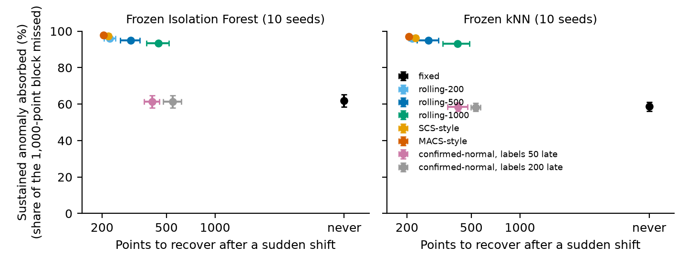

# threshold-under-drift

When normal data shifts, should you move the alarm threshold, and how? This is a small, reproducible
test of fixed and adaptive thresholds on the scores of one frozen anomaly detector. The order is:
first check whether the scores still separate normal from anomalous after the shift, then compare
thresholds on the same frozen model, with updates that only see the past.

Everything runs in about 2 minutes on a laptop CPU. It is a small prototype, not a benchmark.
A 4-page write-up is in [note/threshold-under-drift.pdf](note/threshold-under-drift.pdf).



## Setup

**Streams**

- **Synthetic** - 8 features, Gaussian normal data. 8,000 points per stream, 2% single-point anomalies
  (current normal mean plus a push of 4.5 in a random direction). Five versions:
  - no shift (control)
  - sudden - the normal mean moves 3 SDs along one direction at t = 2,000 and stays
  - gradual - the same move, spread linearly over t = 2,000 to 3,500
  - recurring - shifted for t = 2-3k, 4-5k and 6-7k, back to the start in between
  - sustained anomaly - normal data never moves, but t = 4,000 to 4,999 is a block of anomalies that
    looks exactly like the sudden shift (same direction, same size). This tests the hard part: an
    adaptive rule that follows a new normal will also follow this block.
- **Real** - [UCI Gas Sensor Array Drift](https://archive.ics.uci.edu/dataset/224/gas+sensor+array+drift+dataset)
  (Vergara et al., 2012), 128 features from 16 chemical sensors over 36 months in 10 batches. Batch 1
  trains and calibrates the detector; batches 2-10 stream in time order (rows shuffled inside each
  batch). Acetaldehyde rows are the anomalies (3% of each batch); the other five gases are normal.
  Nothing is injected: the sensors age.

**Frozen detectors** - Isolation Forest (200 trees) and kNN distance (mean distance to the 10 nearest
training rows). Each is fit once on 2,000 clean rows and never updated. A separate set of 1,000 clean
rows (batch 1 rows for gas) gives the calibration scores.

**Threshold rules** (budget = 2.5% false alarms; every rule decides on point t from scores before t)

| Rule | What it does |
|---|---|
| fixed | 97.5% quantile of the calibration scores, never changed |
| rolling-200 / 500 / 1000 | 97.5% quantile of the last 200, 500 or 1,000 scores |
| SCS-style | online regimes + per-regime bound + percentile filter (see below) |
| MACS-style | three windows (50, 100, 500) + variance-based weights + regime check + percentile filter |
| confirmed-normal, labels 50 or 200 late | 97.5% quantile of the last 500 points whose label has come back as normal; labels arrive 50 or 200 points late |

Only the last rule uses labels. All the others see the raw, unlabeled score stream, anomalies included.

**SCS-style and MACS-style vs the paper.** These follow Li and Gautam,
[arXiv:2508.06638](https://arxiv.org/abs/2508.06638) (Section 3), with these changes:

- The paper's SCS segments the series with APCA or k-means. Here the segments have to be found online
  from past scores only: a new segment starts when the mean of the last 100 scores is more than 0.75
  segment SDs from the current segment's mean, and an older segment is reused if the recent mean
  matches it.
- Bounds are upper-only (a high score means anomalous); the paper uses two-sided bounds.
- Bound = mean + k x SD of the segment or window. By default k is set so the bound sits at the 97.5%
  point of the calibration scores, which puts every rule on the same alarm budget. The paper's
  constant (1.5 x SD, widened by 1.2 at confidence above 95%, so k = 1.8) is run too, as
  "SCS-style (paper k=1.8)" and "MACS-style (paper k=1.8)" in the CSVs.
- Percentile filter = 90th percentile of all past scores (I did not find a value for this filter in
  the paper's method section).
- MACS-style: the 0.7 and 0.3 variance cut points are applied to scores standardized by the
  calibration SD; "historical" in the regime test is the 500 scores before the current 500.

## Results (mean over 10 seeds; gas over 5 seeds)

**1. Score separation first** (`results/summary_separation.csv`, `summary_gas_auroc.csv`)

| AUROC | before change | after change |
|---|---|---|
| Synthetic sudden, Isolation Forest | 0.974 | 0.859 |
| Synthetic sudden, kNN | 0.983 | 0.896 |
| Synthetic no shift, Isolation Forest | 0.974 | 0.972 |
| Gas, kNN (batch 1 vs batches 2-10) | 0.831 | 0.049 to 0.674 by batch, 5 of 9 below 0.5 |

On the synthetic streams separation drops but holds. On gas it breaks.

**2. Sudden shift, frozen Isolation Forest** (`results/summary_synthetic.csv`; ± is a 95% interval over seeds)

| Rule | False alarms before | False alarms, first 500 after | Points to recover | Recall after | Sustained block missed |
|---|---|---|---|---|---|
| fixed | 2.8% | 38.0% ± 4.7 | never (10 of 10) | 0.88 | 62% |
| rolling-200 | 1.8% | 4.1% ± 1.0 | 224 ± 18 | 0.38 | 96% |
| rolling-500 | 1.5% | 6.2% ± 1.2 | 301 ± 41 | 0.38 | 95% |
| rolling-1000 | 1.7% | 9.2% ± 1.4 | 448 ± 71 | 0.39 | 93% |
| SCS-style | 2.3% | 3.7% ± 0.9 | 219 ± 7 | 0.29 | 97% |
| MACS-style | 2.0% | 2.2% ± 0.6 | 204 ± 1 | 0.29 | 98% |
| confirmed-normal, labels 50 late | 2.7% | 12.0% ± 1.6 | 408 ± 44 | 0.42 | 61% |
| confirmed-normal, labels 200 late | 2.7% | 21.5% ± 2.6 | 548 ± 70 | 0.44 | 61% |

"Points to recover" = points after the shift until the false-alarm rate over the last 200 normal
points first drops to 5% (2x budget). The shortest possible value is about 204, since the window has
to fill with post-shift points. "Sustained block missed" = share of the 1,000-point anomaly block that
raised no alarm; the fixed threshold already misses 62% because the block scores only partly above it,
so that is the floor.

What it shows:

- Every score-only adaptive rule recovers from the shift, and every one of them also absorbs the
  sustained anomaly. The faster the recovery, the more it absorbs. Looking only at scores, the two
  cases are the same event.
- Labels that come back 50 points late break the tie: the block stays as visible as under the fixed
  threshold, and the rule still recovers from a real shift, about 200 points slower.
- With 2% unlabeled anomalies in the window, rolling quantiles run under budget even with no shift
  (1.3% vs 2.9% for fixed) and catch fewer anomalies (recall 0.71 vs 0.81). The anomalies push the
  quantile up.
- kNN, gradual and recurring shifts give the same picture (see `summary_synthetic.csv`).

**3. Real sensor drift** (kNN, batches 2-10 pooled): the fixed threshold flags 87% of normal rows.
Rolling-500 brings that to 3.2%, but recall falls to 1.0%. SCS-style and MACS-style land in the same
place (2.7% and 2.3% recall). Once separation is gone, no threshold rule gets it back.

## Run it

```
pip install -r requirements.txt
./reproduce.sh            # downloads the 10 MB gas data, runs everything, rebuilds tables and figures
python3 -m pytest -q tests
```

Two runs give byte-identical CSVs.

Files: `src/streams.py` (data), `src/detectors.py`, `src/thresholds.py` (all rules), `src/metrics.py`,
`src/run_all.py`, `src/summarize.py`. Tests check that every rule is past-only (changing future scores
never changes a past alarm), that the fixed rule hits its budget on i.i.d. scores, and that the
confirmed-normal rule does not absorb a labeled block.

## Limits

- One shift size (3 SDs), one anomaly type, one contamination rate (2%). Synthetic data is Gaussian.
- The SCS-style and MACS-style rules are my online versions; their regime settings (100 points, 0.75
  SD) were picked once and not tuned. They are not the authors' code.
- The gas anomalies are a different gas, so "anomaly" there means "a gas the detector never saw".
- The delayed-label rule assumes every label eventually comes back. Real feedback is usually partial.

## Credit

- Thresholds - Muyan Anna Li and Aditi Gautam, "Segmented Confidence Sequences and Multi-Scale
  Adaptive Confidence Segments for Anomaly Detection in Nonstationary Time Series", arXiv:2508.06638 (2025).
- Data - A. Vergara et al., "Chemical gas sensor drift compensation using classifier ensembles",
  Sensors and Actuators B 166-167 (2012); UCI Machine Learning Repository, CC BY 4.0.

Made by Aarush Kandukoori
