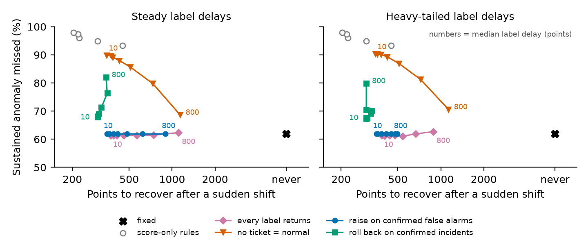
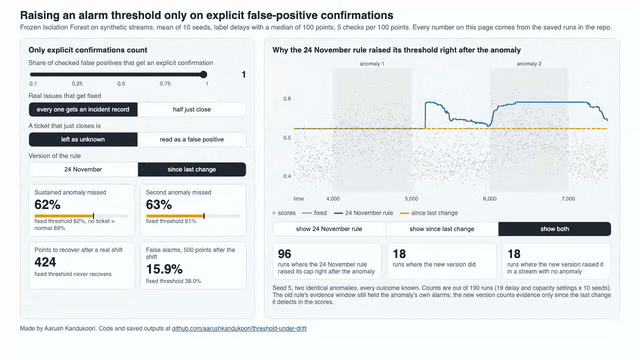
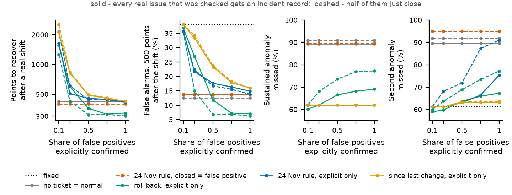
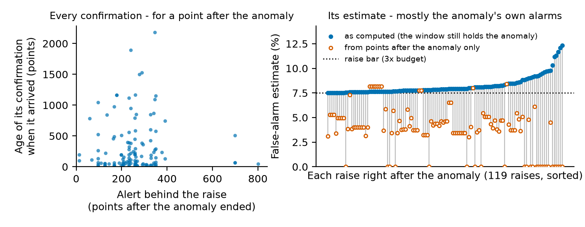
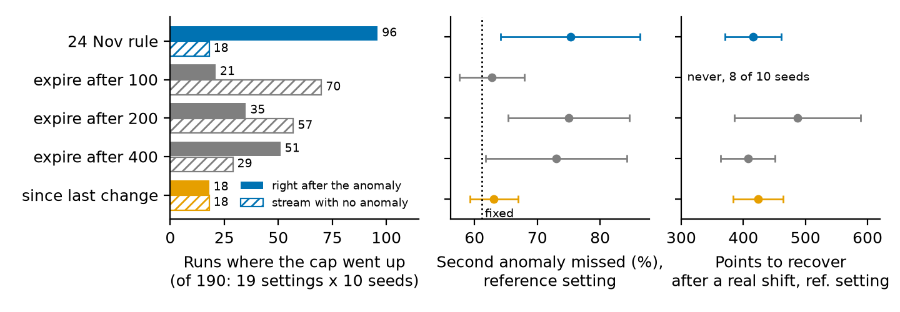

# threshold-under-drift

When normal data shifts, should you move the alarm threshold, and how? This is a small, reproducible
test of fixed and adaptive thresholds on the scores of one frozen anomaly detector. The order is:
first check whether the scores still separate normal from anomalous after the shift, then compare
thresholds on the same frozen model, with updates that only see the past.

It is a small prototype, not a benchmark. A 4-page write-up of the first test is in
[note/threshold-under-drift.pdf](note/threshold-under-drift.pdf).

**Follow-up (November 2026):** label delays drawn per alert and labels only for alerts that get
checked. See [the section below](#follow-up---label-delays-and-partial-feedback) and the 3-page
write-up in [note/delays-and-partial-feedback.pdf](note/delays-and-partial-feedback.pdf).

**Second follow-up (November 2026):** only explicit false-positive confirmations count, and where
the false-alarm rule's raises right after an anomaly came from, with a fix. See
[the section below](#second-follow-up---explicit-confirmations-and-stale-feedback) and the 3-page
write-up in [note/explicit-confirmations-and-stale-feedback.pdf](note/explicit-confirmations-and-stale-feedback.pdf).


## Setup

**Streams**

- **Synthetic** - 8 features, Gaussian normal data. 8,000 points per stream, 2% single-point anomalies
  (current normal mean plus a push of 4.5 in a random direction). Five versions:
  - no shift (control)
  - sudden - the normal mean moves 3 SDs along one direction at t = 2,000 and stays
  - gradual - the same move, spread linearly over t = 2,000 to 3,500
  - recurring - shifted for t = 2-3k, 4-5k and 6-7k, back to the start in between
  - sustained anomaly - normal data never moves, but t = 4,000 to 4,999 is a block of anomalies that
    looks exactly like the sudden shift (same direction, same size). This tests the hard part: an
    adaptive rule that follows a new normal will also follow this block.
- **Real** - [UCI Gas Sensor Array Drift](https://archive.ics.uci.edu/dataset/224/gas+sensor+array+drift+dataset)
  (Vergara et al., 2012), 128 features from 16 chemical sensors over 36 months in 10 batches. Batch 1
  trains and calibrates the detector; batches 2-10 stream in time order (rows shuffled inside each
  batch). Acetaldehyde rows are the anomalies (3% of each batch); the other five gases are normal.
  Nothing is injected: the sensors age.

**Frozen detectors** - Isolation Forest (200 trees) and kNN distance (mean distance to the 10 nearest
training rows). Each is fit once on 2,000 clean rows and never updated. A separate set of 1,000 clean
rows (batch 1 rows for gas) gives the calibration scores.

**Threshold rules** (budget = 2.5% false alarms; every rule decides on point t from scores before t)

| Rule | What it does |
|---|---|
| fixed | 97.5% quantile of the calibration scores, never changed |
| rolling-200 / 500 / 1000 | 97.5% quantile of the last 200, 500 or 1,000 scores |
| SCS-style | online regimes + per-regime bound + percentile filter (see below) |
| MACS-style | three windows (50, 100, 500) + variance-based weights + regime check + percentile filter |
| confirmed-normal, labels 50 or 200 late | 97.5% quantile of the last 500 points whose label has come back as normal; labels arrive 50 or 200 points late |

Only the last rule uses labels. All the others see the raw, unlabeled score stream, anomalies included.
The confirmed-normal rule assumes full coverage: every point's true label comes back, alarm or no
alarm. Real tickets do not give that, so the follow-up below drops this assumption.

**SCS-style and MACS-style vs the paper.** These follow Li and Gautam,
[arXiv:2508.06638](https://arxiv.org/abs/2508.06638) (Section 3), with these changes:

- The paper's SCS segments the series with APCA or k-means. Here the segments have to be found online
  from past scores only: a new segment starts when the mean of the last 100 scores is more than 0.75
  segment SDs from the current segment's mean, and an older segment is reused if the recent mean
  matches it.
- Bounds are upper-only (a high score means anomalous); the paper uses two-sided bounds.
- Bound = mean + k x SD of the segment or window. By default k is set so the bound sits at the 97.5%
  point of the calibration scores, which puts every rule on the same alarm budget. The paper's
  constant (1.5 x SD, widened by 1.2 at confidence above 95%, so k = 1.8) is run too, as
  "SCS-style (paper k=1.8)" and "MACS-style (paper k=1.8)" in the CSVs.
- Percentile filter = 90th percentile of all past scores (I did not find a value for this filter in
  the paper's method section).
- MACS-style: the 0.7 and 0.3 variance cut points are applied to scores standardized by the
  calibration SD; "historical" in the regime test is the 500 scores before the current 500.

## Results (mean over 10 seeds; gas over 5 seeds)

**1. Score separation first** (`results/summary_separation.csv`, `summary_gas_auroc.csv`)

| AUROC | before change | after change |
|---|---|---|
| Synthetic sudden, Isolation Forest | 0.974 | 0.859 |
| Synthetic sudden, kNN | 0.983 | 0.896 |
| Synthetic no shift, Isolation Forest | 0.974 | 0.972 |
| Gas, kNN (batch 1 vs batches 2-10) | 0.831 | 0.049 to 0.674 by batch, 5 of 9 below 0.5 |

On the synthetic streams separation drops but holds. On gas it breaks.

**2. Sudden shift, frozen Isolation Forest** (`results/summary_synthetic.csv`; ± is a 95% interval over seeds)

| Rule | False alarms before | False alarms, first 500 after | Points to recover | Recall after | Sustained block missed |
|---|---|---|---|---|---|
| fixed | 2.8% | 38.0% ± 4.7 | never (10 of 10) | 0.88 | 62% |
| rolling-200 | 1.8% | 4.1% ± 1.0 | 224 ± 18 | 0.38 | 96% |
| rolling-500 | 1.5% | 6.2% ± 1.2 | 301 ± 41 | 0.38 | 95% |
| rolling-1000 | 1.7% | 9.2% ± 1.4 | 448 ± 71 | 0.39 | 93% |
| SCS-style | 2.3% | 3.7% ± 0.9 | 219 ± 7 | 0.29 | 97% |
| MACS-style | 2.0% | 2.2% ± 0.6 | 204 ± 1 | 0.29 | 98% |
| confirmed-normal, labels 50 late | 2.7% | 12.0% ± 1.6 | 408 ± 44 | 0.42 | 61% |
| confirmed-normal, labels 200 late | 2.7% | 21.5% ± 2.6 | 548 ± 70 | 0.44 | 61% |

"Points to recover" = points after the shift until the false-alarm rate over the last 200 normal
points first drops to 5% (2x budget). The shortest possible value is about 204, since the window has
to fill with post-shift points. "Sustained block missed" = share of the 1,000-point anomaly block that
raised no alarm; the fixed threshold already misses 62% because the block scores only partly above it,
so that is the floor.

What it shows:

- Every score-only adaptive rule recovers from the shift, and every one of them also absorbs the
  sustained anomaly. The faster the recovery, the more it absorbs. Looking only at scores, the two
  cases are the same event.
- Labels that come back 50 points late break the tie: the block stays as visible as under the fixed
  threshold, and the rule still recovers from a real shift, about 200 points slower.
- With 2% unlabeled anomalies in the window, rolling quantiles run under budget even with no shift
  (1.3% vs 2.9% for fixed) and catch fewer anomalies (recall 0.71 vs 0.81). The anomalies push the
  quantile up.
- kNN, gradual and recurring shifts give the same picture (see `summary_synthetic.csv`).

**3. Real sensor drift** (kNN, batches 2-10 pooled): the fixed threshold flags 87% of normal rows.
Rolling-500 brings that to 3.2%, but recall falls to 1.0%. SCS-style and MACS-style land in the same
place (2.7% and 2.3% recall). Once separation is gone, no threshold rule gets it back.

## Follow-up - label delays and partial feedback

The confirmed-normal rule above gets every point's true label after a fixed delay, whether or not
the point raised an alarm. Real feedback has two problems that rule ignores. Turnaround varies, and
only alerts that someone checks come back with a label, so a point with no ticket has no label at all.
This part tests both. Code in `src/feedback.py`, runs in `src/run_feedback.py`, tables and figures
in `src/summarize_feedback.py`.

**Feedback model**

- **Delays** - every label gets its own delay, drawn once per seed. *Steady*: uniform between 0.5x
  and 1.5x the median. *Heavy-tailed*: lognormal with the same median and sigma 1.5 (about 1 label
  in 6 takes more than 4x the median, and about 1 in 10 comes back within 0.15x). Medians from 10 to
  800 points.
- **Coverage** - only an alert can be checked, and only while the team has time: at most c checks
  per 100 points on average, first come, first served. A checked alert comes back as a confirmed
  incident or a confirmed false positive. A point that raised no alert, or an alert nobody had time
  to check, never gets a label. c = 1, 2, 5, 10, 25 or every alert.
- Same frozen detectors and synthetic streams as above (10 seeds), plus gradual drifts that take
  500 or 2,000 points. Reference setting: median delay 100 points, heavy-tailed, 5 checks per 100
  points.

**Rules that use feedback**

| Rule | Labels it sees | What it does |
|---|---|---|
| every label returns | every point | the confirmed-normal rule above (last 500 confirmed normals), with a delay per point. A best case |
| no ticket = normal | checked alerts | a point counts as normal once the median delay passes with no incident ticket for it. This is the confirmed-normal rule fed with real tickets |
| raise on confirmed false alarms | checked alerts | threshold = the lower of the rolling-500 proposal and a cap. The cap starts at the fixed threshold. It rises to the proposal only when a checked alert comes back as a false positive and the checked alerts from the 500 points before it put the false-alarm rate above 3x the budget (alarms x share of returned labels that were false). Silence never raises it, and the threshold can always come down. This is the version of 24 November; the second follow-up changes which points the estimate uses |
| roll back on confirmed incidents | checked alerts | follows rolling-500. When 8 of the last 10 returned labels are confirmed incidents, it drops back to the lowest threshold at which one of them fired, and holds until fewer than 5 of the last 10 are incidents |

These settings were set by hand. The false-alarm rule was adjusted on trial runs with 4 of the 10
seeds: earlier gates and a 2x bar let its cap creep up during normal running, so it uses the
500-point estimate with a 3x bar. The 8 of 10 was picked once. Nothing else was tuned.

**Results at the reference setting** (frozen Isolation Forest, mean over 10 seeds, ± is a 95% interval;
`results/summary_feedback_ref.csv`)

| Rule | Labels | False alarms, first 500 after shift | Points to recover | Sustained block missed | No shift: false alarms / recall |
|---|---|---|---|---|---|
| fixed | none | 38.0% ± 4.7 | never (10 of 10) | 62% | 2.9% / 0.80 |
| rolling-500 | none | 6.2% ± 1.2 | 301 ± 41 | 95% | 1.4% / 0.71 |
| MACS-style | none | 2.2% ± 0.6 | 204 ± 1 | 98% | 1.9% / 0.73 |
| every label returns | every point | 14.6% ± 1.3 | 477 ± 40 | 61% | 2.7% / 0.79 |
| no ticket = normal | checked alerts | 13.8% ± 2.2 | 421 ± 38 | 89% | 2.3% / 0.77 |
| raise on confirmed false alarms | checked alerts | 14.9% ± 1.7 | 416 ± 45 | 62% | 2.8% / 0.80 |
| roll back on confirmed incidents | checked alerts | 7.0% ± 1.5 | 323 ± 43 | 69% | 1.5% / 0.72 |



What it shows:

- Treating no ticket as normal brings the absorption back: 89% of the sustained block is missed.
  Checking every alert still leaves 83%, because most of the block never raises an alert and so never
  gets a ticket.
- Raising the threshold only on confirmed false alarms missed exactly the same share of the block as
  the fixed threshold in all 190 runs (19 delay and capacity settings x 10 seeds), and it still
  recovered from the real shift. With no shift it behaves like the fixed threshold. It has a weak
  spot right after the anomaly (see the limits below).
- Rolling back on confirmed incidents flips the trade. It recovers in about 300 to 350 points at
  every delay, but its misses grow with the delay: 68% at a median of 10 points, 82% at 800 (steady delays).
- Delay mostly costs recovery, and how much depends on how fast the stream drifts
  ([figure 6](results/fig6_delay_vs_drift_speed.png)). With steady delays, going from a 10-point to
  a 200-point median raised the false-alarm rule's false alarms from 11.4% to 22.5% in the 500 points
  after a sudden shift, from 7.4% to 12.8% during a drift over 500 points and from 5.2% to 5.9%
  during a drift over 2,000 points (fixed: 38.0%, 25.9% and 17.5%).
- Heavy tails help a rule that needs only a few labels. At a median delay of 800 points it recovered
  in 496 points with heavy-tailed delays and in 895 with steady ones.
- Capacity ([figure 7](results/fig7_checks_capacity.png)): with 1 check per 100 points the
  false-alarm rule still matched the fixed threshold on the block, but took 744 points to recover;
  from 2 checks per 100 points on, it took 374 to 420.
- [Figure 8](results/fig8_thresholds_over_time.png) shows the thresholds over time for one seed.
- kNN gives the same pattern (`summary_feedback_knn.csv`). On the gas stream, feedback does not bring
  separation back: with kNN, the false-alarm rule ends at 3.9% false alarms and 1.4% recall
  (`summary_feedback_gas.csv`).

**Limits of this part**

- The false-alarm rule lets false alarms climb to about 3x the budget before it moves. On the slow
  drift it ran at about 5% false alarms even with short delays, against 2.5% for rolling-500.
- Right after the sustained anomaly its cap went up in 96 of the 190 runs (4 of 10 seeds at the
  reference setting, 1 of 10 with every alert checked; column `n_raised` in
  `results/feedback_runs.csv`), and the cap never comes back down. The second follow-up below traces
  where those raises came from, tests a second anomaly and fixes the estimate.
- Labels are always right, delays do not depend on the alert, and checks are first come, first served.

## Second follow-up - explicit confirmations and stale feedback

Two checks on the rule that raises the threshold only on confirmed false alarms. Code in
`src/feedback.py`, runs in `src/run_confirmations.py`, tables and figures in
`src/summarize_confirmations.py`. Same frozen detectors, synthetic streams and feedback model as
above, plus a stream with two identical anomalies (t = 4,000 to 4,999 and 6,000 to 6,999; the
first 6,000 points match the sustained-anomaly stream). A 3-page write-up is in
[note/explicit-confirmations-and-stale-feedback.pdf](note/explicit-confirmations-and-stale-feedback.pdf).

[](https://aarushkandukoori.github.io/threshold-under-drift/video.html)

A [small explorer page](https://aarushkandukoori.github.io/threshold-under-drift/) (built from the
saved results by `src/make_explorer.py`) lets you change the share of confirmed false positives and
compare the two versions of the rule. The 65-second [demo video](https://aarushkandukoori.github.io/threshold-under-drift/video.html)
walks through it (narration and captions).

**What changed in the code**

- `raise_on_false_alarms` now builds its false-alarm estimate only from alarms and returned labels
  since the last change flagged by a new score-only test, `flag_changes`, and it drops confirmations
  for points before that change. Until now it always used the 500 points before the confirmed false
  positive, even when those points straddled a change.
- `flag_changes` compares the mean of the last 50 scores with the mean of up to 500 scores before
  them, never reaching back past the last change. It flags a change when the two differ by more than
  6 standard errors, then puts the start of the change at the split that best separates the two
  means. It never looks at labels. Over 30 seeds it flagged the sudden shift and both ends of every
  anomaly in every run, a median of 26 to 31 points after the change, and put the start within 27
  points of the true change (median 1). In the stream with no change it fired once in 60 runs (kNN
  scores, seed 21, at t = 3,474; the anomaly streams share that stretch of data and got the same
  extra flag). It flagged the 500-point drift once or twice in 59 of 60 runs and the 2,000-point
  drift in 2 of 30 seeds (`results/summary_change_flags.csv`, from `src/check_change_test.py`).
- The version of 24 November is still there as `changes=None`. `run_feedback.py` uses it, so the
  first follow-up's numbers do not change (rerun after this change: the same CSVs, byte for byte).
- New options: `explicit` (a ticket that closes with no explicit outcome is unknown and is never
  counted), `max_age` (expire confirmations older than a window; tested below, off by default) and
  `log` (one record per raise of the cap).

**Check 1 - only explicit false-positive confirmations count**

A checked false positive is explicitly confirmed as one with probability f (0.1, 0.25, 0.5, 0.75
or 1); otherwise its ticket just closes. A real issue that gets fixed also ends up closed, so a
checked incident gets an incident record with probability g (1, or 0.5 when half of them just close).
Rules either use explicit outcomes only, with a plain closure left as unknown, or read every closure
without an incident record as a false positive. Reference delay and capacity (median 100 points,
heavy-tailed, 5 checks per 100 points), 10 seeds; `results/summary_explicit.csv`.



- With explicit confirmations only, the false-alarm rule (both versions) missed 62% of the sustained
  anomaly at every f and g, the same as the fixed threshold.
- Reading every plain closure as a false positive brings the absorption back as soon as real issues
  can close without a record: about 90% missed at g = 0.5, close to treating no ticket as normal.
- Fewer confirmations cost recovery time. The new version recovered from a real shift in 424 points
  with every false positive confirmed, 490 with half, 817 with a quarter and about 2,100 with a tenth
  (false alarms in the first 500 points after the shift: 15.9%, 23.3%, 33.3% and 38.0%; fixed 38.0%).
- With g = 0.5 the 24 November estimate also missed far more of a second anomaly (up to 91% at
  f = 1). The new version stayed at 61% to 64% (fixed 61%).

**Check 2 - where the raises right after the anomaly came from**

Every raise of the cap is logged (`results/raise_log.csv`) with the age of the confirmation behind
it, the part of the stream its alert came from, and how much of the estimate's evidence came from an
earlier part. Summary in `results/summary_raises.csv`.



- Every one of the 119 raises right after the anomaly (in 96 of 190 runs) was triggered by a
  confirmation from after the anomaly. Each was for an alert 14 to 802 points after the anomaly
  ended; it had taken 6 to 2,179 points to come back (median 140).
- The earlier part got in through the evidence. The 500-point window still held the anomaly: a median
  91% of the alarms the estimate counted were the anomaly's own alarms, and only about 12% of those
  had been checked, against about 78% of the alarms after it. So the false-positive share of the few
  new labels was applied to hundreds of anomaly alarms (estimate median 7.9%, real false-alarm rate in
  the window median 4.2%).
- With evidence from after the anomaly only, 108 of the 119 raises would not have happened. The
  other 11 were all in seed 8, where false alarms on normal points in those windows really were 7% to 8%.
- Stale confirmations do matter when a second anomaly follows. In the two-anomaly stream, 19 of those
  raises came from confirmations of points between the anomalies that arrived after the second one
  had started.

**Fixes tested** (`results/summary_fix_ref.csv`, `results/summary_fix_settings.csv`)



| Version of the false-alarm rule | Runs with a raise right after the anomaly (of 190) | Runs with a raise, no anomaly (of 190) | Second anomaly missed | Points to recover | Recall right after the anomaly |
|---|---|---|---|---|---|
| (fixed threshold) | - | - | 61% | never | 0.82 |
| 24 November | 96 | 18 | 75% ± 11 | 416 ± 45 | 0.78 |
| expire after 100 points | 21 | 70 | 63% ± 5 | never in 8 of 10 seeds | 0.81 |
| expire after 200 points | 35 | 57 | 75% ± 10 | 487 ± 102 | 0.75 |
| expire after 400 points | 51 | 29 | 73% ± 11 | 407 ± 44 | 0.75 |
| since last change (new default) | 18 | 18 | 63% ± 4 | 424 ± 41 | 0.82 |

The first two number columns count runs over all 19 delay and capacity settings x 10 seeds. The
last three are at the reference setting, mean over 10 seeds (± is a 95% interval). "Recall right
after the anomaly" = share of the point anomalies in the 1,000 points after it that raised an alarm.

- Expiring old confirmations did not fix it. Short windows make the estimate noisy, so the cap went
  up during normal running instead (57 to 70 runs of 190), and with 100 points the rule mostly never
  recovered from a real shift. With 400 points it still raised right after the anomaly in 51 runs.
- Counting only evidence since the last flagged change cut the runs with a raise right after the
  anomaly from 96 to 18 of 190. All 18 are seed 8, the same seed where the rule raises in the stream
  with no anomaly (18 of 190 runs). The second anomaly was missed at exactly the fixed threshold's rate
  in 174 of 190 runs (24 November version: 94); the other 16 are seed 8, where the cap had gone up on
  those real false alarms and stayed up.
- Recovery from a real shift was about the same at the reference setting (424 vs 416 points) and
  within 40 points at 14 of the 19 settings. It was slower when labels are scarce: 1,086 vs 744
  points with 1 check per 100 points, 626 vs 420 with 2, and 565 vs 475, 636 vs 496 and 986 vs 895
  at median delays of 400 (heavy-tailed), 800 (heavy-tailed) and 800 (steady). The estimate now waits
  for 5 labels from after the change, where before labels from before the change counted toward those 5.
- [Figure 11](results/fig11_two_anomalies_seed5.png) shows both versions over time on one seed.
  kNN and 20 fresh seeds (10 to 29, reference setting) give the same picture (`summary_fix_ref.csv`,
  `summary_fresh.csv`): on the fresh seeds, runs with a raise right after the anomaly went from 6 of
  20 to 0 of 20 with either detector.

**Settings.** The change test's settings (50 recent points, 6 standard errors, 100 to 500 reference
points) were picked from the score scale before any run. Two things changed after trial runs on
seeds 0 to 3: the spread now comes from the reference scores (the first version flagged extra
changes in kNN scores after the shift), and the estimate now starts where the change began instead of
where it was flagged (starting at the flag dropped the first checks after a shift and slowed recovery
on seed 0). Seeds 5 and 7 were run once to test the code. Nothing else was tuned. Every seed is reported.

## Run it

```
pip install -r requirements.txt
./reproduce.sh            # downloads the 10 MB gas data, runs everything, rebuilds tables and figures
python3 -m pytest -q tests
```

The first test runs in about 2 minutes on a laptop CPU; the feedback sweep and each part of the
second follow-up take a few more minutes with 3 to 4 worker processes (set `WORKERS` to change that).
Runs are seeded, so repeat runs give the same CSVs.

Files - `src/streams.py` (data), `src/detectors.py`, `src/thresholds.py` (score-only rules and the
confirmed-normal rule), `src/feedback.py` (delays, checks and the feedback rules), `src/metrics.py`,
`src/run_all.py` and `src/summarize.py` (first test), `src/run_feedback.py` and
`src/summarize_feedback.py` (follow-up), `src/run_confirmations.py`,
`src/summarize_confirmations.py`, `src/check_change_test.py` and `src/make_explorer.py` (second
follow-up; the explorer page and demo video are in `docs/`). Tests check that every rule is past-only
(changing future scores or labels never changes a past alarm), that the fixed rule hits its budget on
i.i.d. scores, that the confirmed-normal rule does not absorb a labeled block, that flipping the true
label of a point nobody checked changes nothing, that silence never raises the false-alarm rule's
threshold, that labels are never used before they arrive, and that checks stay within capacity. The
second follow-up adds tests that `changes=None` matches a frozen copy of the 24 November rule, that
flipping the true label of a ticket that closed with no explicit outcome changes nothing, that the
change test is past-only, finds a step within 100 points (start within 10) and stays quiet on 20,000
points with no change, that the new estimate does not raise after the sustained anomaly in seed 5
while the old one does, and that it still recovers from a real shift.

## Limits

- One shift size (3 SDs), one anomaly type, one contamination rate (2%). Synthetic data is Gaussian.
- The SCS-style and MACS-style rules are my online versions; their regime settings (100 points, 0.75
  SD) were picked once and not tuned. They are not the authors' code.
- The gas anomalies are a different gas, so "anomaly" there means "a gas the detector never saw".
- The confirmed-normal rule assumes every label comes back. The follow-up section tests partial,
  delayed feedback.
- Second follow-up: the false-alarm rule's cap still never comes back down, so a raise on real false
  alarms (seed 8) stays and a later anomaly is missed more. Labels and explicit outcomes are always
  right, whether a ticket gets an explicit outcome does not depend on the alert, and the change test
  was only tried on these streams, where changes are clean steps or ramps.

## Credit

- Thresholds - Muyan Anna Li and Aditi Gautam, "Segmented Confidence Sequences and Multi-Scale
  Adaptive Confidence Segments for Anomaly Detection in Nonstationary Time Series", arXiv:2508.06638 (2025).
- Data - A. Vergara et al., "Chemical gas sensor drift compensation using classifier ensembles",
  Sensors and Actuators B 166-167 (2012); UCI Machine Learning Repository, CC BY 4.0.

Made by Aarush Kandukoori
